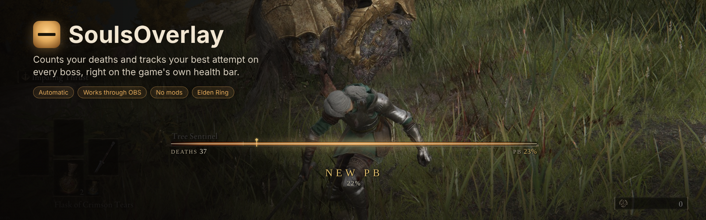
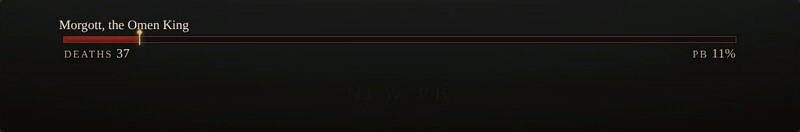
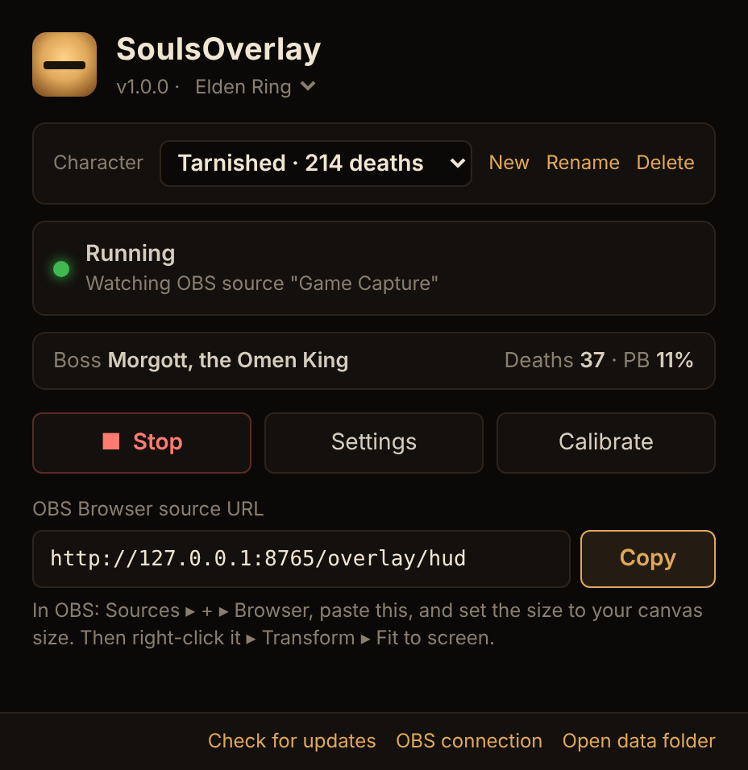

  

**SoulsOverlay** counts your deaths and tracks your best attempt (PB) on every boss, all by
itself, and shows them in OBS right on the game's own health bar. Beat your best and the bar
lights up with **NEW PB**.

   
  Beat your PB and the light runs along the boss's health bar. Pick a colour theme, or colour each part yourself, in the Overlay Editor.

It watches your game through OBS, so it never touches the game: no mods, no memory reading.

Works with **Elden Ring** and **Dark Souls Remastered** out of the box.

## Get started

1. Download **SoulsOverlay.exe** from [Releases](../../releases/latest) and put it in a folder of its own.
2. In OBS, open **Tools → WebSocket Server Settings**, tick **Enable WebSocket server**, click
   **Show Connect Info** and copy the password.
3. Double-click **SoulsOverlay.exe**, then paste the password and the name of your game capture source.
4. Click **Copy** next to the OBS link, add it in OBS as a **Browser** source, and set it to your
   canvas size. Then right-click the new source and choose **Transform → Fit to screen**, so the
   overlay lines up with the game's health bar.

That's it. Fight a boss, and your deaths and PB appear under its health bar.

> **"Windows protected your PC"?** Click **More info**, then **Run anyway**. The exe isn't
> code-signed, which costs money. It's built by GitHub straight from this code.

## The SoulsOverlay window

- **Start / Stop** the tracking.
- **Character:** keep separate deaths and PBs for each character. Switch, add or rename them at the top.
- **Settings** has the **Overlay Editor** (colour themes, a colour for each part of the text, and the NEW PB effect, with a live preview) and the hotkeys.
- **Calibrate** shows it where the game draws its boss bar, if you play on an ultrawide screen or
  changed the HUD scale in Dark Souls Remastered. **Auto-find boss bar** does it for you from a
  frame with a boss at full health, or type in your HUD scale.
- **Updates:** when a new version is out, the window offers it. Click **Update…**, confirm, and
  it restarts on the new version. Your settings and stats are kept.
- Closing the window keeps it running in the tray, so it keeps counting. To have it quit instead, turn off
  **Keep running in the tray** in Settings.

 

## Hotkeys

| Keys | What it does |
|---|---|
| Ctrl+Alt+= | Add a death the counter missed |
| Ctrl+Alt+- | Remove the last death |
| Ctrl+Alt+R | Reset the current boss's deaths and PB |

## Something not working?

The window says what's wrong, for example when it can't reach OBS or can't see the game.
The log is in `data\soulsoverlay.log` next to the exe. For everything else, such as custom CSS,
game profiles, chat bot events and running from source, see the [advanced guide](docs/ADVANCED.md).
